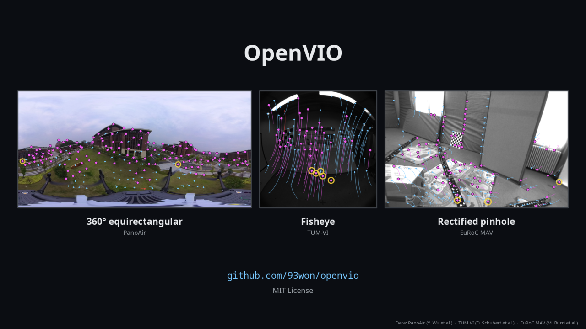

# OpenVIO

Visual-inertial odometry for 360°, pinhole and fisheye cameras.

- **Usage** (build, data, run, evaluate): [doc/usage.md](doc/usage.md)
- **Release notes**: [release_notes/v1.0.0.pdf](release_notes/v1.0.0.pdf)

## Dependencies

- C++17, CMake >= 3.16
- OpenCV >= 4.0, Eigen3 >= 3.3, libpng
- Ceres Solver and spdlog (included in `thirdparty/`)
- GLFW >= 3.3 and OpenGL for the viewer (optional)

## Documentation

| Document | |
|---|---|
| [doc/usage.md](doc/usage.md) | build, get a dataset, run and evaluate |
| [doc/datasets.md](doc/datasets.md) | PanoAir, EuRoC MAV and TUM-VI: download, folder format, settings |
| [doc/configuration.md](doc/configuration.md) | the config file, command-line overrides, stereo |
| [doc/camera_models.md](doc/camera_models.md) | the camera models and how to add one |
| [doc/architecture.md](doc/architecture.md) | modules, the processing of one image, determinism |
| [doc/references.md](doc/references.md) | the papers behind each method, dataset references |

## Datasets

PanoAir (Y. Wu et al., arXiv:2604.00852, [github.com/YYWumm/PanoAir](https://github.com/YYWumm/PanoAir)), EuRoC MAV and
TUM-VI; see [doc/references.md](doc/references.md).

## License

MIT License, see [LICENSE](LICENSE).
